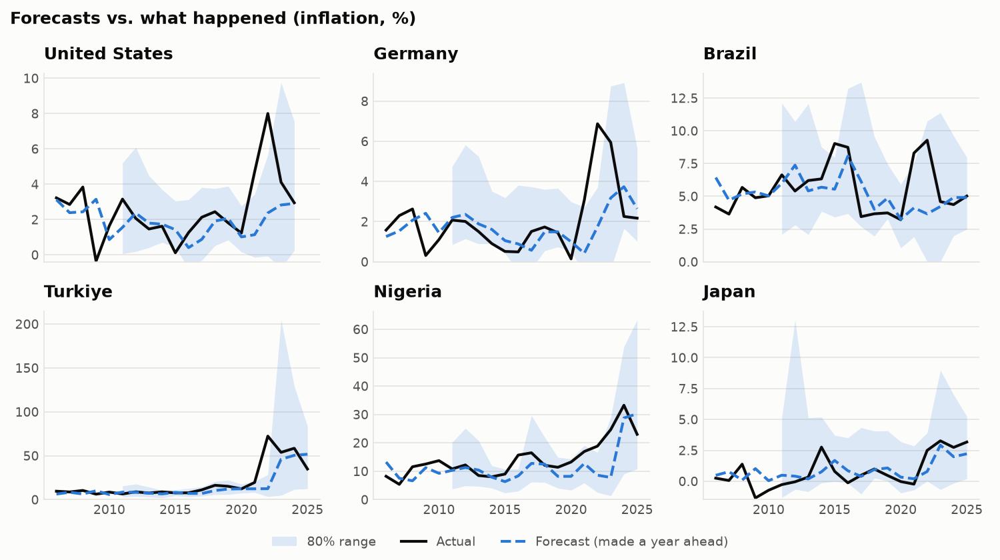
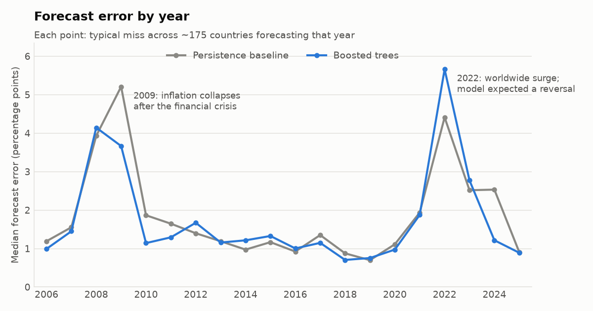
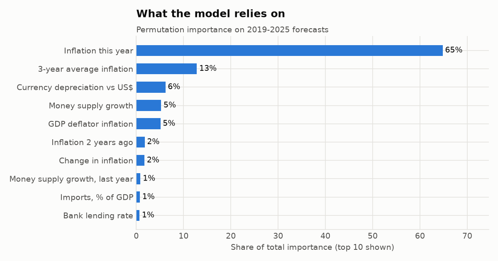

# Next-Year Inflation Forecaster

**Can machine learning beat "inflation next year will be the same as this year"?**
This project forecasts next year's consumer-price inflation for 190+ countries using
World Bank data. It tests every forecast the honest way: the model only ever sees data
that existed at the time the forecast would have been made.



## Results at a glance

Backtest: 3,641 one-year-ahead forecasts for 192 countries, target years 2006–2025.

| | "Same as last year" baseline | Boosted trees (this model) |
|---|---|---|
| Typical miss (median absolute error) | 1.58 pp | **1.44 pp** |
| Forecasts within 2 pp of actual | 57.6% | **61.2%** |
| Mean absolute error (log scale) | 0.556 | **0.506** (9% lower) |
| Years where model beat baseline | – | **14 of 20** |

- **The model beats the baseline by about 9%.** That's a real but modest gain. Inflation is
  very persistent, and "same as last year" is a famously hard benchmark to beat.
- **Most of the skill comes from inflation's own history.** GDP growth, unemployment,
  money supply, interest rates, and exchange rates add very little on top. A model using
  only past inflation does just as well (9.3% vs 9.0%).
- **Gains are largest when inflation is elevated (5–20%).** The typical miss drops from
  2.78 to 2.45 pp (12% better), because the model has learned that elevated inflation tends to come back down.
- **The 80% prediction range really does contain 80% of outcomes (80.6%)**, after calibration.
  Before calibration it caught only 71%.
- **It failed in 2022.** After inflation jumped worldwide in 2021, the model expected
  it to cool off, as similar jumps had in the past. Instead it rose again. This is the
  core limitation of learning from history: it can't foresee a new kind of shock
  (post-pandemic supply chains plus the energy shock from the war in Ukraine).



## The question

Central banks, businesses, and investors all need a view on where inflation is headed.
The simplest forecast, "next year looks like this year," is surprisingly good, so any
model has to prove it adds something beyond that. This project measures exactly how much
it adds, where, and when it breaks down.

## Data

World Bank **World Development Indicators**, accessed through the open-data mirror at
[github.com/datasets/world-development-indicators](https://github.com/datasets/world-development-indicators),
which republishes the official series as CSV files every month. A snapshot from October 2026 is
committed in `data/raw/`, so results are reproducible. Run `python run_all.py --download` to refresh it.

| Variable | WDI code | Why it might matter |
|---|---|---|
| Consumer price inflation (**target**) | FP.CPI.TOTL.ZG | The thing being forecast; also its own best predictor |
| GDP deflator inflation | NY.GDP.DEFL.KD.ZG | A second, broader price measure |
| Broad money (M2) growth | FM.LBL.BMNY.ZG | Printing money fuels high inflation |
| Exchange rate vs US$ | PA.NUS.FCRF | A falling currency makes imports pricier |
| Real GDP growth, unemployment | NY.GDP.MKTP.KD.ZG, SL.UEM.TOTL.ZS | An overheating economy pushes prices up |
| Lending rate, real interest rate | FR.INR.LEND, FR.INR.RINR | Tight money cools inflation |
| Imports, % of GDP | NE.IMP.GNFS.ZS | Open economies import global price shocks |

**Data scope:** 6,180 country-years (193 countries, 1990–2025). Regional and income-group
aggregates such as "World" and "Euro area" are removed, because they are averages of countries
already in the data.

## Method

**1. One row per country per year.** Each row holds what was known at the end of year *t*.
The target is inflation in year *t+1*. Every country gets a row for every year, so
"last year's value" always means the previous calendar year, even when data has gaps.

**2. Features (18).** Inflation this year, the previous two years, the 3-year average,
and the latest change. Also GDP deflator inflation, money growth, currency depreciation (this year and last),
GDP growth, unemployment and its change, interest rates, imports share, and the global median
inflation rate that year and its change.

**3. Signed-log scale.** Inflation runs from about −17% to over 20,000% (hyperinflations
in Venezuela and Zimbabwe). Fitting on raw percentages would let a few extreme years dominate.
Values are transformed with `sign(x)·log(1+|x|)`, which compresses the extremes and still
handles deflation. Predictions are converted back to percent for reporting.

**4. Validation that respects time.**
- **Validation (1996–2005):** used only to choose model settings (`src/tune.py`).
- **Test (2006–2025):** for each year *Y*, the model is retrained on every outcome known
  by the end of *Y−1* and then forecasts *Y* for every country. This is a walk-forward backtest.
  A random train/test split would let the model learn from 2022 to "predict" 2021, which
  inflates scores and is impossible in practice.

**5. Models compared.**

| Model | Mean abs. error (log) | Cut vs. baseline |
|---|---|---|
| Persistence ("same as last year") | 0.556 | – |
| Ridge regression, inflation history only | 0.514 | 7.6% |
| Ridge regression, all features | 0.520 | 6.3% |
| Boosted trees, inflation history only | 0.504 | 9.3% |
| **Boosted trees, all features** (used in the app) | 0.506 | 9.0% |

The boosted trees (scikit-learn `HistGradientBoostingRegressor`) use **absolute-error loss**,
which predicts the median outcome rather than the mean. On the validation years this
cut error by about 10% compared with squared error, because hyperinflation outliers can no
longer drag the fit around.

**6. Prediction ranges that are honest.** Two extra models forecast the 10th and 90th
percentiles. Raw quantile models were overconfident (71% coverage), so each year's range is
widened by how much the ranges missed over the previous 5 years. This is *conformalized
quantile regression* (Romano, Patterson & Candès, 2019), and it uses only past errors.



## Where it helps and where it doesn't

| Inflation this year | Forecasts | Baseline typical miss | Model typical miss |
|---|---|---|---|
| Low (< 5%) | 2,287 | 1.16 pp | **1.06 pp** |
| Elevated (5–20%) | 1,212 | 2.78 pp | **2.45 pp** |
| High (> 20%) | 142 | 12.21 pp | **11.21 pp** |

One feature, the year-over-year change in global inflation, helped on the 1996–2005 validation
years but hurt on 2019–2025, because the model learned that global jumps reverse. It was
kept, because removing it after seeing test results would be tuning on the test set.

## Limitations

- **Data revisions.** The World Bank revises past figures. The backtest uses today's
  revised data, not what forecasters actually saw at the time, so real-time accuracy would
  be somewhat worse.
- **Annual data only.** Monthly prices, commodity prices, and policy announcements would
  likely help a lot but aren't available consistently across 190 countries.
- **Unprecedented shocks.** As 2022 showed, a model trained on history can't anticipate
  a new kind of shock.
- **Reporting lags.** A few countries (including the US and Argentina) don't have 2025 inflation
  published in this release yet, so their latest forecast is for 2025, not 2026. The app labels this.

## Run it yourself

```bash
python -m venv .venv
.venv\Scripts\activate          # Windows   (macOS/Linux: source .venv/bin/activate)
pip install -r requirements.txt
python run_all.py               # ~2 minutes; add --download to fetch fresh data
streamlit run app/streamlit_app.py
```

## Project structure

```
data/raw/                  World Bank snapshot (one CSV per indicator)
data/processed/panel.csv   Country-year table with features and target
src/config.py              Indicator list, paths, settings
src/download_data.py       Step 0: fetch raw data
src/features.py            Step 1: build the country-year table and features
src/tune.py                Step 2: choose settings on validation years only
src/models.py              The five models being compared
src/backtest.py            Step 3: walk-forward backtest + calibrated ranges
src/report.py              Step 4: charts and summary numbers
src/train_final.py         Step 5: final model + next-year forecasts
app/streamlit_app.py       Interactive explorer
reports/                   Backtest results, forecasts, figures
```

## Data license

World Development Indicators © World Bank, licensed under
[CC BY 4.0](https://datacatalog.worldbank.org/public-licenses#cc-by).
